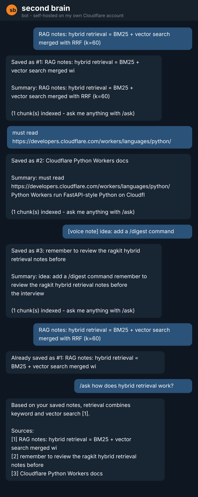
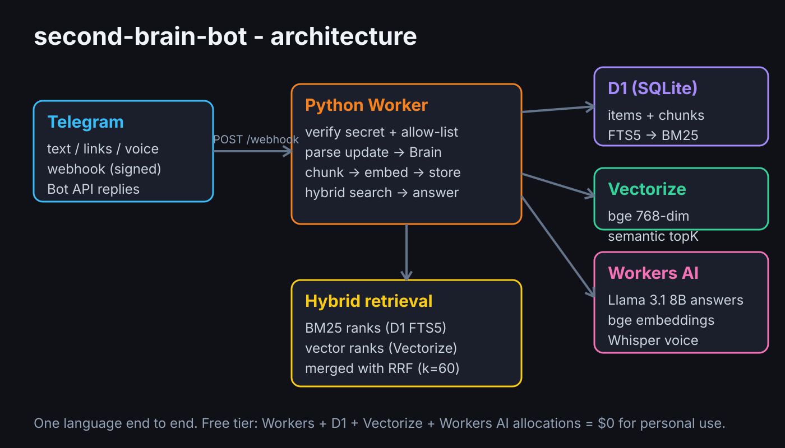

# second-brain-bot

A Telegram "second brain" that runs entirely on a **self-deployed Cloudflare Python Worker** - no server, no Docker, $0 on the free tier.

Forward it anything - text, links, voice notes - and it stores, transcribes and summarizes them. Then ask questions in plain language and it answers **from your saved notes, with sources**, using hybrid retrieval (BM25 + vector search merged with Reciprocal Rank Fusion).

It is not limited to your notes: when a question is not covered by anything you saved, the bot **checks Wikipedia and answers grounded in the article** (labeled, with the source link - so current-fact questions like "who is the prime minister of india?" work despite the model's knowledge cutoff), falling back to a **clearly labeled general answer** only when the web has nothing useful. Follow-up questions work because the bot remembers the last few exchanges, and `/brainstorm`, `/summarize <id>` and `/web` help you think beyond what you saved.



## What it does

| You send | The bot |
| --- | --- |
| plain text (a statement, note or idea) | saves it, writes a 2-3 sentence AI summary, indexes it |
| a question (ends with `?` or starts with who/what/how...) | answers it like `/ask` instead of saving it - forward a question, or add a link, to save it as a note |
| a link | fetches the page, extracts the text, saves page + your note |
| a voice note | transcribes it with Whisper, saves the transcript (+ your caption) |
| the same thing twice | detects the duplicate (sha256) instead of saving again |
| `/ask <question>` | hybrid search over your notes, answer with numbered citations; notes don't cover it? Wikipedia-grounded answer (labeled, with link), else a labeled general-knowledge answer |
| follow-up questions | the last few exchanges are kept as chat memory, so "and the second one?" works |
| `/brainstorm <topic>` | fresh ideas that build on your related saved notes (cited when used) |
| `/summarize <id>` | a fuller, structured summary of one saved item |
| `/get <id>` (`/show`) | read a saved note in full, exactly as stored (very long pages truncated to fit Telegram) |
| `/web <query>` | keyless web lookup (Wikipedia summary), labeled as web - never confused with your notes |
| `/search <words>` (`/find`) | list saved items matching keywords, with ids for `/summarize` and `/forget` |
| `/recent` `/digest` `/stats` | browse, get an AI digest, see counts |
| `/forget <id>` | deletes a saved item for good - item, chunks and embeddings |

## Architecture



- **Cloudflare Python Worker** (`src/entry.py`) - Telegram webhook endpoint. Acknowledges instantly, processes in the background (`ctx.waitUntil`), replies via `sendMessage`.
- **D1 (SQLite)** - items, chunks, and an **FTS5** table for the keyword side of the search (`bm25()` ranking).
- **Vectorize** - 768-dim `@cf/baai/bge-base-en-v1.5` embeddings per chunk for the semantic side.
- **Workers AI** - Llama 3.1 8B (summaries, answers, digests), bge (embeddings), Whisper (voice transcription). Models are wrangler `[vars]`, so they can be swapped without a code change.
- **Hybrid retrieval + relevance threshold** - both rankings merged with **Reciprocal Rank Fusion** (`src/retrieval.py`), then a final gate keeps only chunks the keyword side actually covers or the vector side scores as similar (both backends return *something* for every query, so ranking alone is not enough - this is what keeps a stray note out of an unrelated answer or brainstorm). The surviving chunks become numbered context for the answer prompt.
- **Short-term chat memory** (D1 `turns` table) - the last few Q&A exchanges join both the retrieval query and the answer prompt, so follow-ups resolve. Pruned to 20 turns per chat on every write.
- **Honest fallback** - the answer model replies with a `NO_MATCH` token when the notes do not cover the question. The bot then tries Wikipedia (full article lead, grounded by the model, labeled "From Wikipedia (web, not your notes)" with the source URL), and answers from general knowledge under a "Not from your notes" label only when the web lookup finds nothing usable. No fake citations, no silent stale answers.
- **Keyless web lookup** - `/web` uses Wikipedia's public opensearch + summary APIs, and the `/ask` fallback searches with the question stripped of its question words (opensearch matches titles) and grounds the answer in the full article lead - leads of office-holder articles name the incumbent, which is what "who is the current X?" needs. No API key, no paid service, and every reply names its source.

Everything is Python: one language from webhook to retrieval to prompts.

## Deploy your own (Windows)

You need: a Cloudflare account (free), a Telegram account, Node.js LTS and [uv](https://docs.astral.sh/uv/) installed. All commands below are PowerShell.

**1. Create the bot.** Message [@BotFather](https://t.me/BotFather) on Telegram -> `/newbot` -> copy the token.

**2. Clone and log in.**

```powershell
git clone https://github.com/Prajit-22/second-brain-bot.git
cd second-brain-bot
npx wrangler login
```

**3. Create the database and vector index.**

```powershell
npx wrangler d1 create second-brain-db
# copy the printed database_id into wrangler.toml (database_id = "...")
npx wrangler d1 execute second-brain-db --remote --file=schema.sql
npx wrangler vectorize create second-brain-chunks --dimensions=768 --metric=cosine
```

**4. Set secrets and your chat id.**

```powershell
npx wrangler secret put TELEGRAM_BOT_TOKEN       # the BotFather token
npx wrangler secret put TELEGRAM_WEBHOOK_SECRET  # any long random string you invent
```

Message [@userinfobot](https://t.me/userinfobot) to get your Telegram id and put it in `wrangler.toml` -> `ALLOWED_CHAT_IDS = "123456789"` so only you can use the bot.

**5. Deploy.**

```powershell
uv run pywrangler deploy
# prints https://second-brain-bot.<you>.workers.dev
```

**6. Point Telegram at your worker.**

```powershell
Invoke-RestMethod -Uri "https://api.telegram.org/bot<TOKEN>/setWebhook" -Method Post -Body @{
  url = "https://second-brain-bot.<you>.workers.dev/webhook"
  secret_token = "<same TELEGRAM_WEBHOOK_SECRET as step 4>"
}
```

Done - forward the bot a link and `/ask` it something.

**Upgrading an existing deployment?** Pull the latest code, re-run the schema (it only adds the new chat-memory table) and redeploy:

```powershell
npx wrangler d1 execute second-brain-db --remote --file=schema.sql
uv run pywrangler deploy
```

One-click deploy also works via the button (you still need steps 1, 3, 4 and 6 for the bot token, database, secrets and webhook):

[](https://deploy.workers.cloudflare.com/?url=https://github.com/Prajit-22/second-brain-bot)

## Cost

Runs on the Cloudflare **free tier**: Workers requests, D1, Vectorize and Workers AI (Llama/bge/Whisper) all have daily free allocations sized far beyond personal second-brain use. No credit card required for the free plan.

## Develop and test locally

No Cloudflare account needed for the tests or the demo - the bot's logic is plain Python with the Cloudflare bindings behind one thin adapter (`src/store.py`):

```powershell
pip install -r requirements-dev.txt
python -m pytest tests/ -v          # 167 unit tests
python demo/demo_local.py           # end-to-end demo with in-memory fakes
```

`demo/demo_local.py` drives the **real** Brain + retrieval + prompts code path against in-memory fakes of D1/Vectorize/Workers AI - the same fakes the unit tests use. CI (`.github/workflows/ci.yml`) runs both on Python 3.9-3.12.

## Project layout

```
src/
  entry.py         Worker entry: webhook auth, network calls, wiring (only Cloudflare-aware file)
  brain.py         orchestration: save/ask/search/recent/digest/stats flows
  store.py         thin D1 + Vectorize + Workers AI adapter
  retrieval.py     chunking, tokenizer, FTS5 query building, RRF merge, HTML -> text (pure)
  prompts.py       system/user prompt builders, incl. the NO_MATCH fallback contract (pure)
  web_lookup.py    keyless Wikipedia lookup: URL building + JSON parsing (pure)
  telegram_api.py  update parsing, commands, auth, message splitting (pure)
tests/             167 unit tests + in-memory fakes
demo/demo_local.py end-to-end demo harness (prints the simulated chat above)
schema.sql         D1 schema (items, chunks, FTS5, chat-memory turns)
wrangler.toml      bindings + model config
```

## Design notes (the "why")

- **Why hybrid retrieval?** Pure vector search misses exact keywords ("that Ragas metric", an error string); pure BM25 misses paraphrases ("how do I deploy it" vs "shipping steps"). RRF merges both rankings by rank position only, so neither score scale matters - and a chunk found by both ranks highest.
- **Why D1 FTS5 instead of a second service?** SQLite ships `bm25()` for free, colocated with the metadata, one `schema.sql` to understand.
- **Why acknowledge the webhook instantly?** Telegram retries slow webhooks, which would double-save notes. `ctx.waitUntil` finishes the AI work after the 200, replies go out via the Bot API.
- **Why a relevance threshold *and* a NO_MATCH token?** Vector search always returns *some* nearest chunk and BM25 matches any shared word, so retrieval first applies a hard gate: a chunk enters the context only if the query's content words literally cover it or the vector score clears a bar (`MIN_KEYWORD_RELEVANCE` / `MIN_VECTOR_SCORE` in `src/retrieval.py`). That keeps stray notes out of answers, citations and brainstorms deterministically. The NO_MATCH token is the second layer for what slips through: the model declares "the notes don't cover this" with an exact token, so the labeled general-knowledge fallback can never be mistaken for something you saved.
- **Why Wikipedia for /web?** It is the only decent lookup that is truly keyless and free at any personal scale, and its summary API returns clean, sourced extracts. Anything bigger (a real search API) would need a paid key, which breaks the $0 design goal.
- **Why a webhook secret + chat allow-list?** The worker URL is public; `X-Telegram-Bot-Api-Secret-Token` proves the POST came from Telegram, and `ALLOWED_CHAT_IDS` makes the bot answer only you.
- **Why is everything pure except `entry.py`/`store.py`?** So 167 unit tests and the demo exercise the exact production logic with no Workers runtime - and every line stays explainable.
